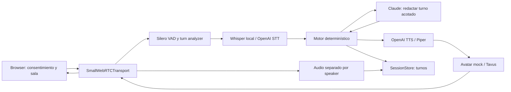
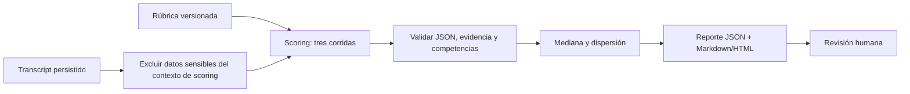

# Arquitectura — propuesta G1

Estado: pendiente de aprobación del responsable. Piloto de screening PM/PO; la recomendación
siempre se revisa por una persona. No contiene decisiones de contratación automáticas.

## Entorno y límites

La instrucción actual del responsable indica ejecutar en el homelab `192.168.2.6` por SSH.
El kit menciona WSL2; el homelab confirmado por el responsable usa ese entorno remotamente.
El homelab tiene Windows 11, WSL2 NVIDIA-Workbench y RTX 3090 de 24 GB;
el orquestador preparó Python 3.12.16 en WSL2 remoto. El stack se mantiene. La ejecución
CUDA de Whisper, permisos de almacenamiento, HTTPS y conectividad WebRTC siguen por verificar.

Una instancia FastAPI sirve páginas y señalización; una sesión mantiene un motor y pipeline.
SQLite almacena entrevistas, consentimiento, turnos y reportes. Los archivos quedan bajo
`DATA_DIR/<UUID>/`. Se permite una sesión activa por entrevista; un límite global de sesiones
debe ajustarse a la GPU medida antes del piloto. No hay multi-tenancy ni colas distribuidas.

## Flujo en vivo

El motor controla fases, seis competencias, máximo dos repreguntas y tiempo; el LLM no
controla transiciones. `consent_check → intro → warmup → competencies → candidate_questions
→ closing → done`. El aviso de IA y grabación se dice explícitamente al inicio.
No se inicia captura ni se llama a proveedores hasta que storage confirme consentimiento
versionado y consumo atómico del token. La sala pide permisos de dispositivos después del
consentimiento. El bot tiene un límite duro de 30 minutos configurable hacia abajo.

## Post-entrevista

Un score numérico requiere referencias a turnos del candidato existentes, pertenecientes a
esta entrevista y pertinentes a la competencia; el validador del scoring verifica esas
relaciones antes de guardar. Los contratos validan estructura e invariantes locales. No
pueden comprobar solos la pertinencia semántica de una evidencia. Falta de evidencia
produce `score=null, insufficient_evidence=true`. Dispersión >1 agrega una alerta.
No se usan audio, imagen, acento, apariencia ni información demográfica para puntuar.

## Contratos y ownership

`src/ai_interviewer/contracts.py` es la frontera común, sin SDKs externos. Modelos Pydantic
rechazan campos extra. Los IDs son UUID; tiempos de turnos son segundos desde el inicio
en un mismo reloj monotónico; fechas persistidas requieren zona horaria.

| Dueño | Responsabilidad | Frontera |
|---|---|---|
| architect | contratos, configuración, ADRs | modelos y Protocols |
| interview-engine | fases, preguntas, scoring | InterviewEngine, EngineDecision, InterviewReport |
| pipeline-engineer | WebRTC, servicios, mock/Tavus | InterviewEngine, AvatarService, RecordingChunk |
| web-api | autenticación, consentimiento, storage | SessionStore, Interview, ConsentRecord |
| qa-evals | escenarios y métricas | mismas interfaces con dobles offline |

Los métodos de motor y storage son async; `transcript()` devuelve una copia del snapshot.
El pipeline envía `EngineEvent` por silencio, límite duro o finalización voluntaria. El límite
duro/finalización termina sin otra llamada LLM. `restore()` reconstruye el motor desde estado
y turnos persistidos sin emitir audio; la API valida antes credencial y deadline original.
El inicio de habla invalida respuestas pendientes mediante un epoch. Si la respuesta todavía
no se entregó, el coordinador guarda el turno real del candidato y descarta el motor que ya
pudo haber avanzado internamente. `InterviewEngineFactory` crea uno nuevo; `restore()` recibe
la última fase, competencia y contador de repreguntas entregados, el deadline original y el
transcript comprometido más ese turno real. Solo avanza el tiempo transcurrido. La pregunta
generada pero no entregada nunca se incorpora al storage ni al motor restaurado. No hay
aborto por una interrupción normal ni llamadas a proveedores al reconstruir. La persistencia
y la reanudación deben usar el mismo checkpoint; un fallo de storage detiene la sesión.
Si el inicio de habla ocurre durante la persistencia de una respuesta pendiente,
`replace_progress()` restaura snapshot y transcript en una transacción: conserva todos
los turnos reales del candidato y elimina solamente respuestas del entrevistador aún no
entregadas. Exige consentimiento activo, ownership y deadline idéntico; no toca audio ni
reportes. La entrega lógica ocurre cuando `output.text` acepta el mensaje para encolar,
no constituye un acuse de reproducción del navegador. Antes de ese límite se puede revertir;
después se conserva el turno visible/encolado y el barge-in corta únicamente audio pendiente.
La API autoriza la sesión y crea un motor nuevo por entrevista. `SessionStore` hace cumplir
consentimiento en escrituras de audio/turnos y en claim atómico. Un token de invitación de
32 bytes aleatorios expira en siete días; solo su SHA-256 se guarda. El claim lo consume y
la API emite una credencial de sesión independiente, de corta duración, ligada al UUID.
Reanudación usa esa credencial, nunca reactiva el token consumido; queda limitada por el
deadline original. El detalle de señalización y autenticación de reanudación se prueba en
fase 2. Tokens y credenciales no se escriben en logs de acceso.

## Latencia y fallas

Presupuesto objetivo p50 desde fin de habla hasta primer audio del avatar, **sin medir aún**:

| Etapa | Presupuesto |
|---|---:|
| Detección de fin de turno | 200 ms |
| STT final | 200 ms |
| Motor + primer texto LLM | 300 ms |
| Primer audio TTS | 250 ms |
| Avatar + transporte | 200 ms |
| Total | 1150 ms |

Se registra p50/p95 por etapa y total con reloj monotónico, solo IDs técnicos sin contenido.
Estos valores son hipótesis para el probe real, no garantías. Si el avatar necesita buffers
mayores, se informa el incumplimiento y se evalúa audio solo; no se cambia el umbral sin revisión.

| Falla | Comportamiento previsto |
|---|---|
| STT local falla | OpenAI STT si hay credencial/configuración; si no, pausar y avisar |
| LLM tarda/falla | Timeout acotado; una repetición y pregunta base segura de la fase actual |
| TTS falla | Piper si está instalado; si no, texto visible y sesión marcada degradada |
| Tavus falla | Cortar avatar y continuar audio, con aviso y flag |
| Candidato interrumpe | Cancelar generación/audio y vaciar buffer del avatar |
| Silencio 20 s | Evento al motor para repetir/reformular, con máximo temporal global |
| Desconexión | Persistir estado; reanudar con credencial de sesión y deadline original |
| Storage falla | Detener captura y sesión; no seguir acumulando datos sin persistencia |

Retries y fallbacks son acotados y no deben duplicar audio, turnos ni consumo de tokens.
El pipeline debe verificar clases y parámetros contra Pipecat instalado 1.15.0 y ejemplos
oficiales del tag antes de implementar. Esta fase no importa ni supone APIs de Pipecat.

## Privacidad, seguridad y alcance

`/admin/*` requiere API key por header y comparación constante. Las claves nunca se serializan
para diagnósticos. TLS es obligatorio fuera de localhost; CORS se limita al origen configurado.
Consentimiento explícito, indicador de grabación y botón de finalizar son requisitos de sala.
IP se guarda con HMAC-SHA256 y secreto aparte. No se loguean URLs con tokens ni transcripts.
Grabación de audio del candidato/bot es separada; grabación de video y formato quedan para
revisión de alcance en G1 antes de implementarlos. Tavus transmite video y debe explicitarse
como destinatario de datos en el consentimiento cuando se habilite.

Retención propuesta: 30 días desde cierre (o creación si nunca empezó), luego borrar datos
personales, turnos, reportes y archivos. Solo sobreviven agregados sin IDs ni texto libre.
Borrado solicitado aplica a todo el conjunto; backups necesitan política de vencimiento
compatible y restauración que no resucite registros borrados. Ver ADR-003.

Antes de producción: revisión legal, HTTPS y TURN medidos, autenticación robusta, límites
por proveedor y concurrencia, backups/restore probados, política de retención efectiva y
calibración humana. Antes del piloto: G2 rúbrica, G3 evals pagas, G4 Tavus y G5 go/no-go.

## Dependencias verificadas

Pins directos consultados en la API oficial de PyPI el 2026-11-02:
[Pipecat 1.15.0](https://pypi.org/pypi/pipecat-ai/1.15.0/json),
[Pydantic](https://pypi.org/pypi/pydantic/json),
[pydantic-settings](https://pypi.org/pypi/pydantic-settings/json),
[FastAPI](https://pypi.org/pypi/fastapi/json), [pytest](https://pypi.org/pypi/pytest/json).
Pipecat está en extra `realtime`; CI de contratos instala `.[test]` sin servicios ni GPU.
`make install` instala también Pipecat. Extras de proveedores/CUDA se agregarán por el dueño
del pipeline después de inspeccionar el wheel y resolver en el homelab. Los pins directos
no equivalen a un lock transitivo; se generará lock resuelto tras validar ese entorno.

## Decisiones para G1

1. Aprobar arquitectura y contratos async para construir módulos en paralelo.
2. Medir Whisper/CUDA en el homelab confirmado; GPU visible ya verificada.
3. Confirmar alcance de grabación: audio separado; decidir si también se exige video persistido.
4. Confirmar retención propuesta de 30 días y responsable/contacto de privacidad antes del piloto.
