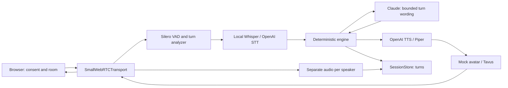
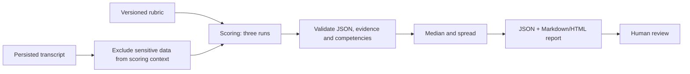

# Architecture — G1-approved baseline

Status: baseline approved by the owner at G1; outstanding scope decisions are listed below.
PM/PO screening pilot; a person always reviews the recommendation. No automated hiring decisions.

## Environment and boundaries

The owner currently directs execution over SSH on homelab `192.168.2.6`. The kit specifies
WSL2; the confirmed remote homelab provides that environment: Windows 11, WSL2
NVIDIA-Workbench and a 24 GB RTX 3090. The orchestrator prepared Python 3.12.16 in remote
WSL2. The stack is unchanged. Whisper CUDA execution, storage permissions, HTTPS and
WebRTC connectivity were still unverified at this architecture checkpoint.

One FastAPI instance serves pages and signaling; a session owns an engine and pipeline.
SQLite stores interviews, consent, turns and reports. Files live under `DATA_DIR/<UUID>/`.
Allow one active session per interview; tune a global session limit against measured GPU
capacity before the pilot. No multitenancy or distributed queues.

## Live flow

The engine controls phases, six competencies, at most two follow-ups and timing; the LLM
does not control transitions:
`consent_check → intro → warmup → competencies → candidate_questions → closing → done`.
Explicitly speak the AI and recording disclosure at the start. Do not capture media or
call providers until storage confirms versioned consent and atomic token consumption.
The room requests device permissions after consent. The bot has a hard 30-minute limit,
configurable downward.

## After the interview

A numeric score requires existing candidate turn references from this interview that
are relevant to the competency. The scoring validator checks those relationships before
saving. Contracts validate structure and local invariants; they cannot independently
establish semantic relevance. Missing evidence produces
`score=null, insufficient_evidence=true`. Spread >1 adds an alert. Never score audio,
image, accent, appearance or demographic information.

## Contracts and ownership

`src/ai_interviewer/contracts.py` is the shared boundary, with no external SDKs. Pydantic
models reject extra fields. IDs are UUIDs. Turn times are seconds from a shared monotonic
origin; persisted dates require timezone information.

| Owner | Responsibility | Boundary |
|---|---|---|
| architect | Contracts, configuration, ADRs | Models and Protocols |
| interview-engine | Phases, questions, scoring | InterviewEngine, EngineDecision, InterviewReport |
| pipeline-engineer | WebRTC, services, mock/Tavus | InterviewEngine, AvatarService, RecordingChunk |
| web-api | Authentication, consent, storage | SessionStore, Interview, ConsentRecord |
| qa-evals | Scenarios and metrics | Same interfaces with offline doubles |

Engine and storage methods are async; `transcript()` returns a snapshot copy. The pipeline
sends `EngineEvent` for silence, hard limit or voluntary termination. The hard limit and
termination end the session without another LLM call. `restore()` rebuilds the engine
from persisted state/turns without speaking; the API first validates the credential and
original deadline.

Speech onset invalidates pending responses through an epoch. If a response has not been
delivered, the coordinator saves the actual candidate turn and discards the engine,
which may already have advanced internally. `InterviewEngineFactory` creates a new one;
`restore()` receives the last delivered phase, competency and follow-up count, original
deadline, and committed transcript plus the actual turn. Only elapsed time advances.
A generated but undelivered question never enters storage or the restored engine. Normal
interruptions do not abort the session; reconstruction never calls providers. Persistence
and resume must use the same checkpoint; storage failure stops the session.

If speech begins while a pending response is being persisted, `replace_progress()`
restores snapshot and transcript transactionally: preserve every actual candidate turn
and remove only undelivered interviewer responses. Require active consent, ownership and
an identical deadline; do not touch audio or reports. Logical delivery occurs when
`output.text` accepts a message into the queue, not when the browser acknowledges playback.
Before this boundary, rollback is possible; afterward preserve the visible/queued turn,
and barge-in cuts only pending audio.

The API authorizes sessions and creates one engine per interview. `SessionStore` enforces
consent on audio/turn writes and atomic claims. A random 32-byte invitation token expires
in seven days; persist only its SHA-256 hash. Claiming consumes it, and the API issues an
independent, short-lived session credential bound to the UUID. Resume uses that credential,
never reactivates the invitation, and remains limited by the original deadline. Test
signaling and resume authentication in Phase 2. Never log tokens or credentials in access logs.

## Latency and failures

Target p50 budget from end of speech to first avatar audio, **not yet measured**:

| Stage | Budget |
|---|---:|
| End-of-turn detection | 200 ms |
| Final STT | 200 ms |
| Engine + first LLM text | 300 ms |
| First TTS audio | 250 ms |
| Avatar + transport | 200 ms |
| Total | 1150 ms |

Record per-stage and total p50/p95 with a monotonic clock, technical IDs only, no content.
These numbers are hypotheses for real probing, not guarantees. If the avatar requires
larger buffers, report the missed target and assess audio-only operation; do not change
the threshold without review.

| Failure | Intended behavior |
|---|---|
| Local STT failure | OpenAI STT if configured with credentials; otherwise pause and notify |
| Slow/failed LLM | Bounded timeout; one repeat and a safe base question for the current phase |
| TTS failure | Piper if installed; otherwise visible text and a degraded-session flag |
| Tavus failure | Stop the avatar and continue audio, with notification and flag |
| Candidate interruption | Cancel generation/audio and clear avatar buffers |
| 20 seconds of silence | Engine repeat/rephrase event, within the global time limit |
| Disconnect | Persist state; resume using session credentials and the original deadline |
| Storage failure | Stop capture and session; do not accumulate unpersisted data |

Retries/fallbacks must be bounded and cannot duplicate audio, turns or token spending.
Before implementation, verify pipeline classes/parameters against installed Pipecat 1.15.0
and official tagged examples. This architecture phase neither imports nor assumes Pipecat APIs.

## Privacy, security and scope

`/admin/*` requires a header API key and constant-time comparison. Never serialize keys
for diagnostics. TLS is mandatory outside localhost; restrict CORS to the configured
origin. Explicit consent, a recording indicator and an End button are room requirements.
Store IP addresses with HMAC-SHA256 and a separate secret. Never log token URLs or transcripts.
Record candidate/bot audio separately. Video recording and format await G1 scope review
before implementation. Tavus transmits video and must be identified as a data recipient
in consent when enabled.

Proposed retention: 30 days from closure, or creation if never started. Then delete
personal data, turns, reports and files. Only aggregates without IDs or free text survive.
Requested deletion covers the entire dataset. Backups need compatible expiry and restore
procedures that cannot resurrect deleted records. See ADR-003.

Before production: legal review, measured HTTPS/TURN, robust authentication, provider and
concurrency limits, tested backup/restore, effective retention, and human calibration.
Before the pilot: G2 rubric, G3 paid evaluations, G4 Tavus, G5 go/no-go.

## Verified dependencies

Direct pins checked against official PyPI APIs on 2026-11-02:
[Pipecat 1.15.0](https://pypi.org/pypi/pipecat-ai/1.15.0/json),
[Pydantic](https://pypi.org/pypi/pydantic/json),
[pydantic-settings](https://pypi.org/pypi/pydantic-settings/json),
[FastAPI](https://pypi.org/pypi/fastapi/json), [pytest](https://pypi.org/pypi/pytest/json).
Pipecat is in the `realtime` extra; contract CI installs `.[test]` without services or GPU.
`make install` also installs Pipecat. The pipeline owner will add provider/CUDA extras
after inspecting the wheel and resolving them in the homelab. Direct pins are not a
transitive lock; generate a resolved lock after validating that environment.

## G1 decisions

1. Approve architecture and async contracts for parallel module development.
2. Measure Whisper/CUDA on the confirmed homelab; GPU visibility is already verified.
3. Confirm recording scope: separate audio, and whether persisted video is also required.
4. Confirm the proposed 30-day retention and privacy owner/contact before the pilot.
