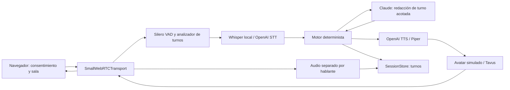
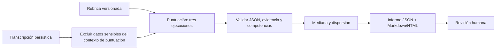

# Arquitectura — línea base aprobada en G1

Estado: línea base aprobada por el dueño en G1; las decisiones de alcance pendientes se
listan a continuación.
Piloto de selección PM/PO; una persona siempre revisa la recomendación. Sin decisiones
automáticas de contratación.

## Entorno y límites

El dueño dirige la ejecución actualmente por SSH en el homelab `192.168.2.6`. El kit
especifica WSL2; el homelab remoto confirmado provee ese entorno: Windows 11, WSL2
NVIDIA-Workbench y una RTX 3090 de 24 GB. El orquestador preparó Python 3.12.16 en WSL2
remoto. El stack no ha cambiado. La ejecución de Whisper con CUDA, los permisos de
almacenamiento, HTTPS y la conectividad WebRTC aún no estaban verificados en este punto
de la arquitectura.

Una instancia de FastAPI sirve páginas y señalización; una sesión posee un motor y un
pipeline. SQLite almacena entrevistas, consentimientos, turnos e informes. Los archivos
viven en `DATA_DIR/<UUID>/`. Permitir una sesión activa por entrevista; ajustar un límite
global de sesiones según la capacidad GPU medida antes del piloto. Sin multitenencia ni
colas distribuidas.

## Flujo en vivo

El motor controla las fases, seis competencias, como máximo dos seguimientos y el tiempo;
el LLM no controla las transiciones:
`consent_check → intro → warmup → competencies → candidate_questions → closing → done`.
Declarar explícitamente la divulgación de IA y grabación al inicio. No capturar medios ni
llamar proveedores hasta que el almacenamiento confirme el consentimiento versionado y el
consumo atómico de tokens. La sala solicita permisos de dispositivo después del
consentimiento. El bot tiene un límite duro de 30 minutos, configurable a la baja.

## Después de la entrevista

Un puntaje numérico requiere referencias existentes de turnos del candidato en esta
entrevista que sean relevantes para la competencia. El validador de puntuación verifica
esas relaciones antes de guardar. Los contratos validan la estructura e invariantes locales;
no pueden establecer independientemente la relevancia semántica. La evidencia faltante
produce `score=null, insufficient_evidence=true`. Una dispersión >1 agrega una alerta.
Nunca puntuar audio, imagen, acento, apariencia ni información demográfica.

## Contratos y propiedad

`src/ai_interviewer/contracts.py` es el límite compartido, sin SDKs externos. Los modelos
Pydantic rechazan campos extra. Los IDs son UUIDs. Los tiempos de turno son segundos desde
un origen monótono compartido; las fechas persistidas requieren información de zona horaria.

| Dueño | Responsabilidad | Límite |
|---|---|---|
| architect | Contratos, configuración, ADRs | Modelos y Protocolos |
| interview-engine | Fases, preguntas, puntuación | InterviewEngine, EngineDecision, InterviewReport |
| pipeline-engineer | WebRTC, servicios, simulado/Tavus | InterviewEngine, AvatarService, RecordingChunk |
| web-api | Autenticación, consentimiento, almacenamiento | SessionStore, Interview, ConsentRecord |
| qa-evals | Escenarios y métricas | Mismas interfaces con dobles offline |

Los métodos del motor y almacenamiento son async; `transcript()` devuelve una copia
instantánea. El pipeline envía `EngineEvent` para silencio, límite duro o terminación
voluntaria. El límite duro y la terminación finalizan la sesión sin otra llamada al LLM.
`restore()` reconstruye el motor desde el estado/turnos persistidos sin hablar; la API
primero valida la credencial y el plazo original.

El inicio del habla invalida respuestas pendientes mediante una época. Si una respuesta
no ha sido entregada, el coordinador guarda el turno real del candidato y descarta el
motor, que puede haber avanzado internamente. `InterviewEngineFactory` crea uno nuevo;
`restore()` recibe la última fase entregada, competencia y conteo de seguimientos, el plazo
original, y la transcripción comprometida más el turno real. Solo el tiempo transcurrido
avanza. Una pregunta generada pero no entregada nunca entra al almacenamiento ni al motor
restaurado. Las interrupciones normales no abortan la sesión; la reconstrucción nunca
llama a proveedores. La persistencia y la reanudación deben usar el mismo punto de control;
el fallo de almacenamiento detiene la sesión.

Si el habla comienza mientras se persiste una respuesta pendiente, `replace_progress()`
restaura el snapshot y la transcripción transaccionalmente: preservar todos los turnos
reales del candidato y eliminar únicamente las respuestas del entrevistador no entregadas.
Requerir consentimiento activo, propiedad y un plazo idéntico; no tocar audio ni informes.
La entrega lógica ocurre cuando `output.text` acepta un mensaje en la cola, no cuando el
navegador confirma la reproducción. Antes de este límite, el rollback es posible; después,
preservar el turno visible/en cola, y el barge-in corta únicamente el audio pendiente.

La API autoriza sesiones y crea un motor por entrevista. `SessionStore` aplica el
consentimiento en escrituras de audio/turno y reclamaciones atómicas. Un token de
invitación aleatorio de 32 bytes expira en siete días; persistir solo su hash SHA-256.
Reclamarlo lo consume, y la API emite una credencial de sesión independiente y de corta
duración vinculada al UUID. La reanudación usa esa credencial, nunca reactiva la
invitación, y permanece limitada por el plazo original. Probar la señalización y la
autenticación de reanudación en la Fase 2. Nunca registrar tokens ni credenciales en
los logs de acceso.

## Latencia y fallos

Presupuesto p50 objetivo desde el fin del habla hasta el primer audio del avatar,
**aún no medido**:

| Etapa | Presupuesto |
|---|---:|
| Detección de fin de turno | 200 ms |
| STT final | 200 ms |
| Motor + primer texto del LLM | 300 ms |
| Primer audio TTS | 250 ms |
| Avatar + transporte | 200 ms |
| Total | 1150 ms |

Registrar p50/p95 por etapa y total con un reloj monótono, solo IDs técnicos, sin contenido.
Estos números son hipótesis para sondeo real, no garantías. Si el avatar requiere buffers
más grandes, reportar el objetivo incumplido y evaluar la operación solo con audio; no
cambiar el umbral sin revisión.

| Fallo | Comportamiento previsto |
|---|---|
| Fallo del STT local | OpenAI STT si está configurado con credenciales; de lo contrario pausar y notificar |
| LLM lento/fallido | Timeout acotado; una repetición y una pregunta base segura para la fase actual |
| Fallo del TTS | Piper si está instalado; de lo contrario texto visible y una bandera de sesión degradada |
| Fallo de Tavus | Detener el avatar y continuar con audio, con notificación y bandera |
| Interrupción del candidato | Cancelar generación/audio y limpiar buffers del avatar |
| 20 segundos de silencio | Evento de repetición/reformulación del motor, dentro del límite de tiempo global |
| Desconexión | Persistir estado; reanudar con credenciales de sesión y el plazo original |
| Fallo de almacenamiento | Detener la captura y la sesión; no acumular datos no persistidos |

Los reintentos/fallbacks deben estar acotados y no pueden duplicar audio, turnos ni gasto
de tokens. Antes de la implementación, verificar las clases/parámetros del pipeline contra
Pipecat 1.15.0 instalado y los ejemplos oficiales etiquetados. Esta fase de arquitectura
no importa ni asume APIs de Pipecat.

## Privacidad, seguridad y alcance

`/admin/*` requiere una clave API en cabecera y comparación en tiempo constante. Nunca
serializar claves para diagnósticos. TLS es obligatorio fuera de localhost; restringir
CORS al origen configurado. El consentimiento explícito, un indicador de grabación y un
botón de Finalizar son requisitos de la sala. Almacenar direcciones IP con HMAC-SHA256 y
un secreto separado. Nunca registrar URLs de tokens ni transcripciones. Grabar el audio
del candidato y el bot por separado. La grabación de video y el formato esperan la revisión
de alcance G1 antes de la implementación. Tavus transmite video y debe identificarse como
receptor de datos en el consentimiento cuando está habilitado.

Retención propuesta: 30 días desde el cierre, o la creación si nunca se inició. Luego
eliminar datos personales, turnos, informes y archivos. Solo sobreviven agregados sin IDs
ni texto libre. La eliminación solicitada cubre el conjunto de datos completo. Los respaldos
necesitan procedimientos de expiración y restauración compatibles que no puedan resucitar
registros eliminados. Ver ADR-003.

Antes de producción: revisión legal, HTTPS/TURN medido, autenticación robusta, límites de
proveedores y concurrencia, respaldo/restauración probado, retención efectiva y calibración
humana.
Antes del piloto: rúbrica G2, evaluaciones pagadas G3, Tavus G4, go/no-go G5.

## Dependencias verificadas

Pins directos verificados contra las APIs oficiales de PyPI el 2026-11-02:
[Pipecat 1.15.0](https://pypi.org/pypi/pipecat-ai/1.15.0/json),
[Pydantic](https://pypi.org/pypi/pydantic/json),
[pydantic-settings](https://pypi.org/pypi/pydantic-settings/json),
[FastAPI](https://pypi.org/pypi/fastapi/json), [pytest](https://pypi.org/pypi/pytest/json).
Pipecat está en el extra `realtime`; el CI de contratos instala `.[test]` sin servicios ni
GPU. `make install` también instala Pipecat. El dueño del pipeline añadirá extras de
proveedor/CUDA después de inspeccionar el wheel y resolverlos en el homelab. Los pins
directos no son un lock transitivo; generar un lock resuelto después de validar ese entorno.

## Decisiones G1

1. Aprobar la arquitectura y los contratos async para el desarrollo paralelo de módulos.
2. Medir Whisper/CUDA en el homelab confirmado; la visibilidad de la GPU ya está verificada.
3. Confirmar el alcance de grabación: audio separado, y si también se requiere video persistido.
4. Confirmar la retención propuesta de 30 días y el dueño/contacto de privacidad antes del piloto.
